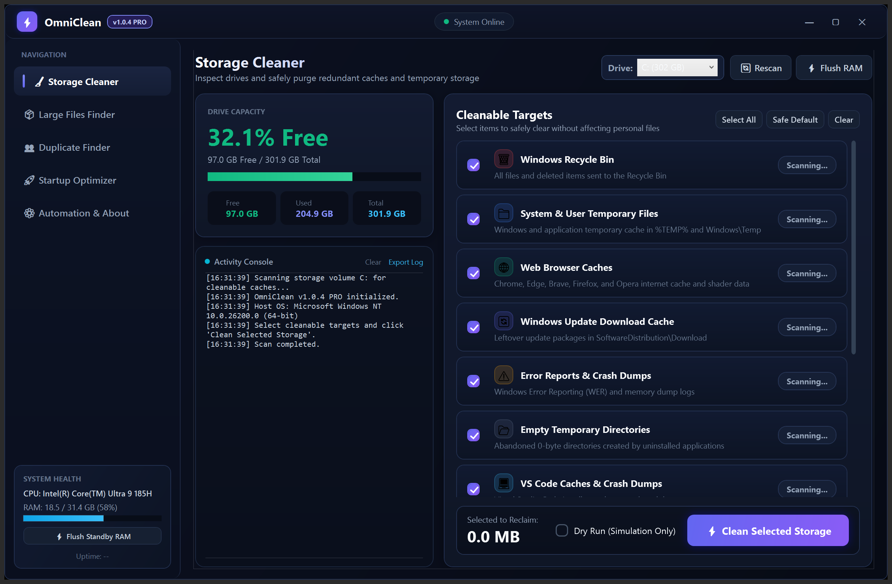

# OmniClean

Version: 1.0.4
Universal Windows Storage Optimizer and Performance Utility.

OmniClean is a native, lightweight Windows desktop application engineered to inspect system drives, reclaim disk space from redundant caches, discover large or duplicate files, trim idle memory working sets, and optimize overall system responsiveness. It ships as a single standalone executable with zero external runtime dependencies (native edition), plus an optional local web edition.

OmniClean ships in two editions that share the same goals:

| Edition | Entry point | Stack |
| :--- | :--- | :--- |
| **Native** | `OmniClean.exe` (built from `OmniClean.cs` via `build.bat`) | C# 5 / WPF, zero runtime dependencies |
| **Web** | `Launch.bat` (starts `server.js` + browser UI in `public/`) | Node.js backend, PowerShell engine (`scan.ps1`, `cleaner.ps1`, `targets.ps1`), browser front end |

The capabilities matrix below describes the native edition in full; the web edition's feature set, API and security model are documented in the [Web Edition](#web-edition) section.



---

## Capabilities Matrix

### What OmniClean Can Do

1. **Storage Drive Analysis and Multi-Volume Support**
   - Automatically detects all active local fixed drives (C:, D:, E:, etc.).
   - Computes capacity, free space, used space, and usage percentage with color-coded safety indicators.
   - Monitors storage metrics dynamically before and after cleaning routines.

2. **Multi-Target Cache and Garbage Purging**
   - **Windows Recycle Bin**: Cleans all user recycle bins via native Win32 `SHEmptyRecycleBin` APIs without confirmation prompts or sound disruptions.
   - **User & System Temp**: Clears temporary directories (`%TEMP%` and `C:\Windows\Temp`).
   - **Universal Browser Cache**: Purges temporary disk cache, GPU shader caches, and code caches across Google Chrome, Microsoft Edge, Brave Browser, Mozilla Firefox, and Opera.
   - **Windows Update Downloads**: Removes stale download payloads in `C:\Windows\SoftwareDistribution\Download` after updates are applied.
   - **Crash Dumps and WER**: Clears user crash dump repositories (`%LOCALAPPDATA%\CrashDumps`) and Windows Error Reporting queue and archive directories.
   - **NVIDIA GPU Update Staging**: Removes leftover driver installer archives in `ProgramData\NVIDIA Corporation\NVIDIA app\UpdateFramework\ota-artifacts`.
   - **CapCut Version Management**: Scans video editing installation folders and prunes obsolete version builds while safeguarding the active build.
   - **VS Code Development Caches**: Purges cached extension `.vsix` installers, Crashpad reports, and editor cached data.
   - **Developer Package Caches**: Clears `npm-cache` and `pip cache` directories to reclaim disk space from accumulated node and python packages.
   - **Discord Media & Shader Caches**: Clears discord cache folders without resetting account sessions.

3. **Dry Run Simulation Mode**
   - Provides a non-destructive simulation toggle (`Dry Run (Simulation Only)`).
   - Allows users to preview potential disk space reclamation and inspect affected directory paths without deleting a single file.

4. **Working Set Memory Optimization**
   - Flushes idle memory pages across active processes via the Windows PSAPI `EmptyWorkingSet` subsystem.
   - Reclaims physical RAM without terminating or restarting background applications.
   - Features real-time RAM load percentage and capacity tracking.

5. **Large File Discovery and Size Filters**
   - Scans user directories recursively to locate hidden files exceeding 100 MB.
   - Features 1-click filter pills: All (>100 MB), Media/Archives (>500 MB), and Huge (>1 GB).
   - Displays file extension badges, file names, file paths, size badges, and provides instant buttons to reveal files in Windows Explorer or safely delete them.

6. **Cryptographic Duplicate File Finder and 1-Click Clean**
   - Employs a fast two-phase duplicate discovery algorithm:
     - Phase 1: Groups candidates by exact file byte size.
     - Phase 2: Computes full-file SHA-256 cryptographic hashes (streamed over the entire file) for size-matched files to ensure 100% byte-level certainty before identifying duplicates.
   - Distinguishes original files with green protected badges and redundant copies with copy badges.
   - Features a 1-click `Delete All Duplicate Copies` action that safely eliminates all duplicate files while keeping 100% of original files intact.

7. **Windows Startup Application Manager**
   - Reads configured auto-launch applications from the Windows Registry (`HKCU\Software\Microsoft\Windows\CurrentVersion\Run` and `HKLM\Software\Microsoft\Windows\CurrentVersion\Run`).
   - Interactive toggle switches: Click to toggle between ACTIVE (emerald badge) and DISABLED (slate badge) states to accelerate PC boot times.

8. **Silent Background Automation**
   - Supports seamless integration with Windows Task Scheduler via native command line execution.
   - Schedules weekly maintenance runs executing `OmniClean.exe --silent-clean` in headless mode.

9. **Diagnostic Activity Logging and Export**
   - Displays real-time operation timestamps and progress details in a built-in terminal console.
   - Provides `Clear` and `Export Log` actions to save cleanup histories and scan reports as standard text files.

10. **Hardware and System Telemetry HUD**
    - Identifies processor architecture, core counts, CPU model, total physical RAM, and live system uptime without requiring external diagnostic tools.

11. **Safety, Auditability, and Control (v1.0.4)**
    - Every cleanup asks for confirmation with an impact summary (selected targets + estimated reclaim) before anything is deleted.
    - Each run writes a deletion manifest to `%APPDATA%\OmniClean\logs\` recording every removed item, every failure with its reason, and a final summary - fully auditable cleanups.
    - Large-file and duplicate scans can be stopped at any time with dedicated Stop buttons.
    - A single-instance guard prevents two OmniClean windows from scanning or cleaning concurrently.
    - Unhandled errors are captured to crash logs instead of closing silently.

---

### What OmniClean Does Not Do (Safety Boundaries)

OmniClean is intentionally engineered with strict safety constraints to prevent data loss or system instability:

1. **Does Not Delete Personal User Documents**
   - OmniClean never touches or removes user files in Documents, Desktop, Pictures, Music, or OneDrive directories during general storage cleanups.
   - Duplicates and large files are only removed when manually reviewed and explicitly deleted by the user.

2. **Does Not Erase Browser Logins, Passwords, or Cookies**
   - Browser cleaning is strictly constrained to cached media, shaders, and temporary rendering files (`Cache`, `Code Cache`, `GPUCache`).
   - Saved passwords, cookies, session tokens, bookmarks, and browsing history are never modified.

3. **Does Not Perform Destructive Registry Cleaning**
   - OmniClean does not run speculative registry sweeps that can corrupt COM interfaces, file associations, or system stability.
   - Registry interaction is exclusively limited to reading and toggling documented startup keys under `Software\Microsoft\Windows\CurrentVersion\Run`.

4. **Does Not Perform SSD Defragmentation**
   - Solid State Drives (SSDs) and NVMe drives experience unnecessary flash cell wear when subjected to traditional defragmentation. OmniClean does not defragment storage media.

5. **Does Not Modify Windows Protected System Files**
   - OmniClean respects Windows File Protection and System File Checker (`SFC`) boundaries. Crucial system DLLs, driver stores, and WinSxS components remain untouched.

6. **Does Not Run Unwanted Background Resident Processes**
   - OmniClean has zero tray icons, zero background daemon services, and zero continuous resource consumption when closed.
   - When automation is enabled, it relies entirely on the built-in Windows Task Scheduler.

---

## Technical Architecture

- **Language**: C# 5 / .NET Framework 4.5+ (Natively pre-installed on Windows 10, Windows 11, and Windows Server).
- **GUI Engine**: Windows Presentation Foundation (WPF) with dark theme and hardware acceleration (native DWM rounded corners and drop shadow on Windows 11).
- **Source Layout**: Three partial-class files - `OmniClean.cs` (window, embedded XAML UI, and wiring), `OmniClean.Engine.cs` (cleanup pipeline and deletion audit trail), `OmniClean.Analysis.cs` (large files, duplicates, startup optimizer).
- **Navigation Layout**: Left Sidebar navigation with active indicator bars and dedicated workspace canvas.
- **Interactive Feedback**: Dynamic card hover effects with illumination highlights.
- **Binary Footprint**: ~186 KB standalone executable with embedded application icon, DPI-aware manifest (Per-Monitor V2), and version metadata.
- **External Dependencies**: Zero for the native executable. No NuGet dependencies, no Python runtime, and no Node.js runtime are required to build or run `OmniClean.exe` (Node.js is only needed for the optional Web Edition).
- **Build System**: Compiles using the native Microsoft Visual C# compiler (`csc.exe`).

---

## Compilation Instructions

OmniClean can be compiled directly on any Windows workstation without installing Visual Studio or third-party SDKs.

### Option 1: Automated Script

Execute `build.bat` from the root directory.

### Option 2: PowerShell Compilation

```powershell
$csc = "C:\Windows\Microsoft.NET\Framework64\v4.0.30319\csc.exe"
$wpfDir = "C:\Windows\Microsoft.NET\Framework64\v4.0.30319\WPF"

& $csc /target:winexe /platform:anycpu /optimize+ /lib:"$wpfDir" `
  /r:PresentationFramework.dll /r:PresentationCore.dll /r:WindowsBase.dll `
  /r:System.Xaml.dll /r:System.dll /r:System.Core.dll `
  /win32icon:"app.ico" /win32manifest:"app.manifest" `
  /out:"OmniClean.exe" "OmniClean.cs" "OmniClean.Engine.cs" "OmniClean.Analysis.cs"
```

---

## Command Line Usage

| Command | Functionality |
| :--- | :--- |
| `OmniClean.exe` | Launches the interactive graphical user interface. |
| `OmniClean.exe --silent-clean` | Executes a headless, background cleanup of temporary caches without opening the GUI window. |
| `OmniClean.exe --validate-xaml` | Parses the embedded UI markup and exits with code 0 (valid) or 1 (invalid); used by CI to catch UI regressions. |

---

## Web Edition

A local, browser-based companion built around a Node.js backend and the same PowerShell cleanup philosophy.

### Requirements

- Windows 10/11 (the cleanup engine is PowerShell-based)
- Node.js 18 or newer available on `PATH`

### Usage

| Command | Function |
| :--- | :--- |
| `Launch.bat` | Starts the local engine (if not already running) and opens the UI in an app window (Chrome/Edge, falls back to the default browser). |
| `Launch.bat stop` | Stops the background engine. |
| `Launch.bat restart` | Restarts the background engine. |
| `npm start` | Starts the backend directly at `http://127.0.0.1:4982`. |
| `set PORT=5000` then `npm start` | Runs the backend on a different port. |
| `npm test` | Runs the smoke test suite (`test/smoke.test.js`). |

The engine logs to `server.log` next to `Launch.bat`.

### Architecture

| File | Role |
| :--- | :--- |
| `targets.ps1` | Single source of truth for cleanable categories, shared by scan and clean. |
| `scan.ps1` | Emits one JSON document: disk metrics, category sizes, scheduler state, system telemetry. |
| `cleaner.ps1` | Deletes the requested categories. Accepts `-Categories "id1,id2"` and `-DryRun` (preview only). |
| `server.js` | Static file host + JSON API, bound to loopback only. |
| `public/` | Browser UI. |

### API

| Endpoint | Method | Description |
| :--- | :--- | :--- |
| `/api/status` | `GET` | Disk usage, category sizes, scheduler state, system info (cached ~20 s). |
| `/api/clean` | `POST` | Body `{"categories": ["recycle_bin", ...]}` - runs `cleaner.ps1` and returns its log lines plus refreshed disk stats. |
| `/api/schedule` | `POST` | Body `{"enable": true}` or `{"enable": false}` - creates/removes a weekly Task Scheduler job (`StorageOptimizerAutoClean`, Sundays 12:00). |

### Security Model

- The server binds to `127.0.0.1` only and emits no CORS headers, so web pages other than the UI cannot read its responses.
- Requests carrying a foreign `Host` header (DNS rebinding) or `Origin` header (cross-site request) are rejected with `403`.
- Category ids are validated against a fixed allowlist in `server.js` and executed via `execFile` (never through a shell), so request data can never become a shell command.
- Static file serving resolves paths and refuses anything outside `public/`.
- `cleaner.ps1` independently re-validates its `-Categories` input and supports `-DryRun`.

### Testing

`npm test` starts the server on a test port and verifies the API contract, the security boundaries above, and that `cleaner.ps1` receives comma-separated categories as separate ids (a regression here would silently disable all cleaning). The only cleaner invocations in tests use `-DryRun` or an invalid id, so the suite never deletes files.

---

## Release Versioning Cadence

OmniClean follows a structured incremental release model:
- Patch versions increment by 0.0.1 from .0 up to .5 (e.g., 1.0.0 -> 1.0.1 -> 1.0.2 -> 1.0.3 -> 1.0.4 -> 1.0.5).
- Upon reaching the .5 boundary, the minor index advances (e.g., 1.0.5 -> 1.1.0 -> 1.1.1 ... -> 1.1.5 -> 1.2.0).
- Major version increments advance with key platform milestones (e.g., 2.0.0 -> 2.0.5 -> 2.1.0 -> 3.0.0).

---

## Repository and CI/CD Pipeline

- **Source Repository**: `https://github.com/Junaed93/OmniClean.git`
- **CI Pipeline**: `.github/workflows/ci.yml` runs the web edition test suite and a native compile check on every push and pull request.
- **Release Automation**: GitHub Actions workflow (`.github/workflows/release.yml`) automatically compiles and attaches `OmniClean.exe` to official GitHub Releases on tag pushes (`v1.0.1`, `v*`).
- **Binary Distribution**: Standalone executables are distributed exclusively through GitHub Releases; no binary `.exe` files are tracked in the Git repository tree.

---

## License

This project is licensed under the MIT License. Free for personal, organizational, and educational use.
